# LLM Random Number Benchmark

<p align="center">
  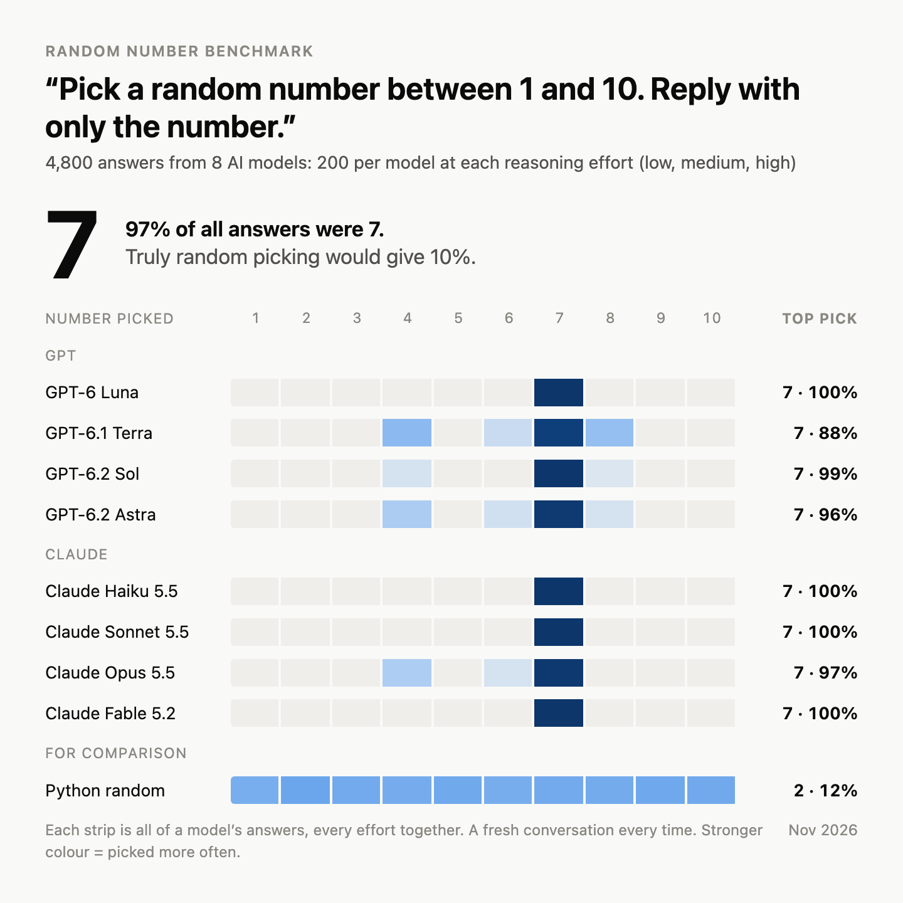
  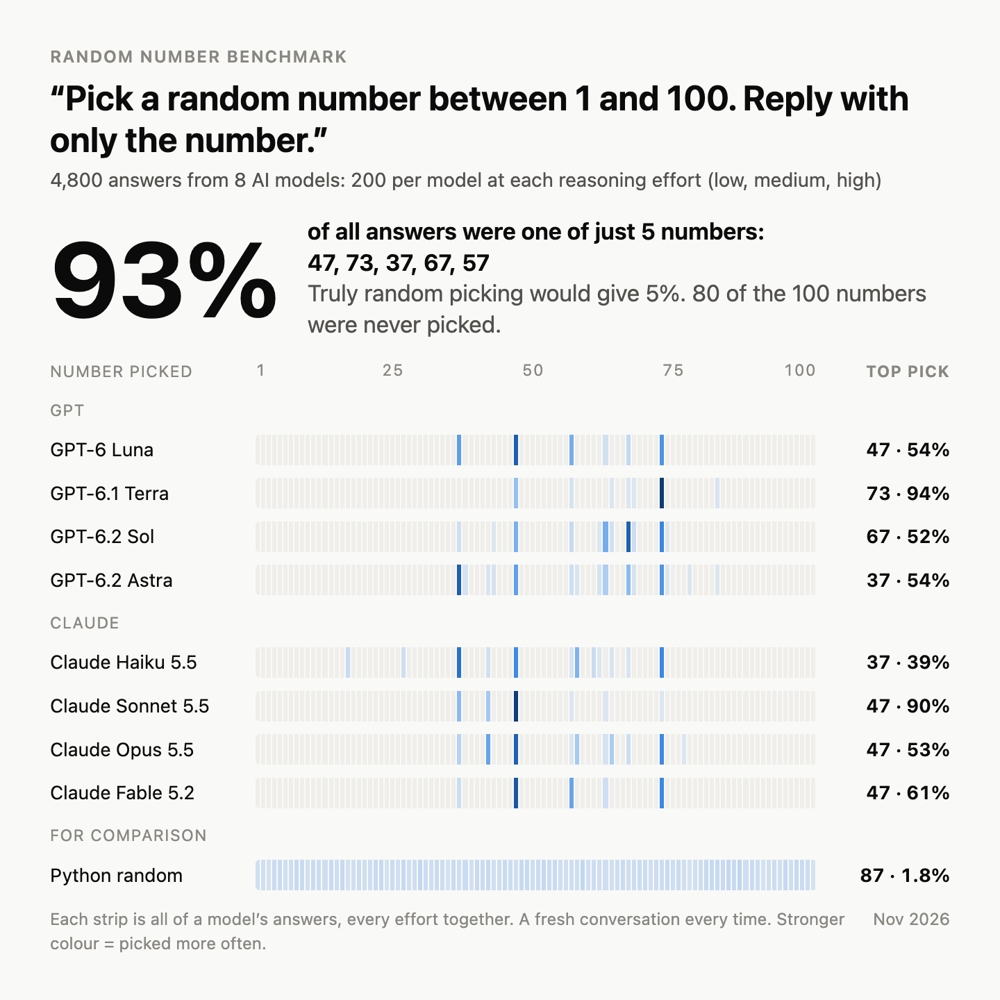
  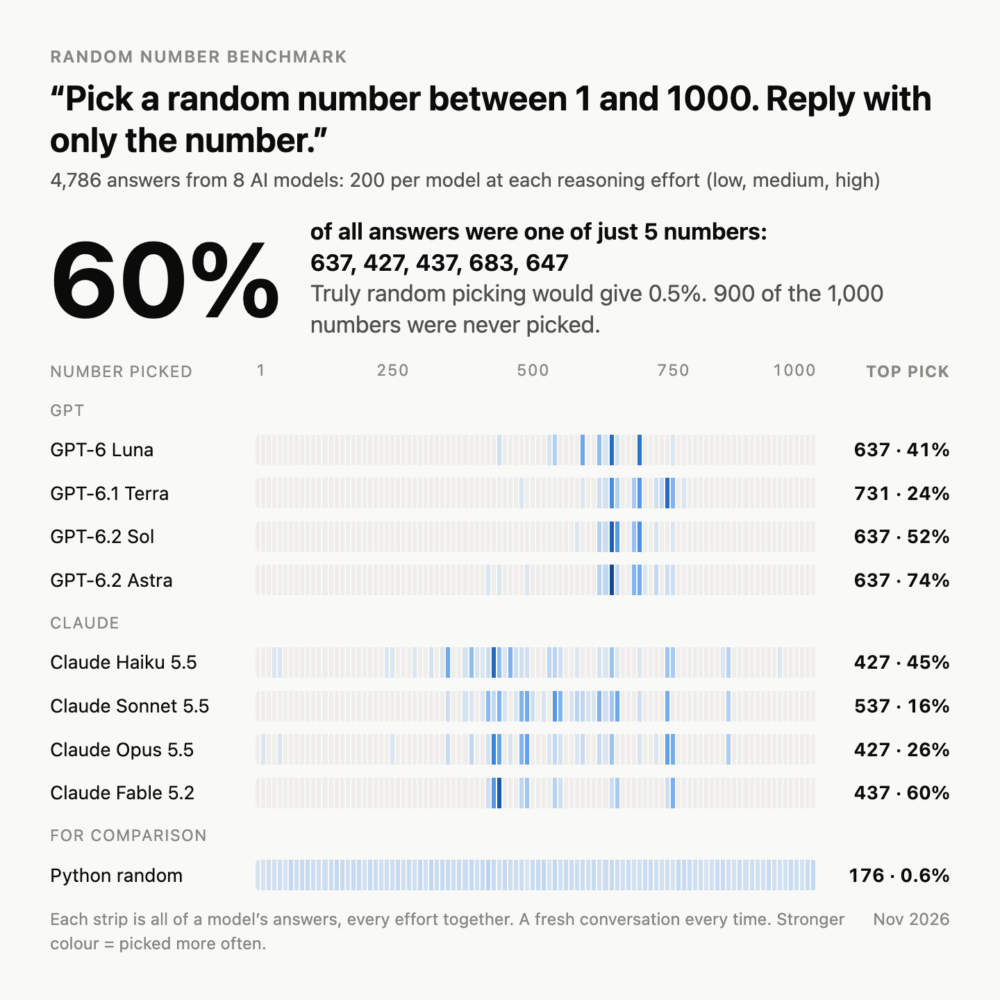
</p>

<p align="center">
  <a href="https://huggingface.co/datasets/diegocp01/llm-random-number-benchmark"></a>
  &nbsp;
  <a href="https://gptaiacademy.com/benchmarks/random-number"></a>
</p>

What happens when you ask a language model to pick a random number, thousands of times?

This benchmark asks GPT and Claude models the same one-line question in a fresh
conversation every time, at three reasoning efforts, and compares their answers
with each other and with a real random number generator.

## Status

| Test | Question | Status | API calls | Cost |
|---|---|---|---|---|
| 1–10 | "Pick a random number between 1 and 10. Reply with only the number." | **Complete** (18 Nov 2026) | 5,600 | $1.31 |
| 1–100 | same, 1 to 100 | **Complete** (18 Nov 2026) | 5,600 | $1.21 |
| 1–1000 | same, 1 to 1000 | **Complete** (19 Nov 2026) | 5,600 | $1.33 |
| 1–10 (Decisions API) | "Pick a random number between 1 and 10." asked of two decision models, with the ten numbers as options | **Complete** (19 Nov 2026) | 1,400 | $0.02 |

All four tests are finished. Their results are below.

## Results: 1–10

**97.5% of all answers were 7** (4,678 of 4,800). A fair random pick gives each number 10%.

- **Six of the ten numbers were never picked.** Not once in 4,800 answers did a model say 1, 2, 3, 5, 9 or 10. Everything that was not a 7 was a 4 (74 times), an 8 (34) or a 6 (14).
- **Both families converge on the same number.** GPT models answered 7 in 95.8% of calls, Claude models in 99.1%. Models from the same family are no closer to each other than models from different families (exact permutation test, p = 0.26), so there is no family signature here: there is one shared favourite.
- **17 of the 24 model × effort combinations answered 7 all 200 times.**
- **Rewording the question changed nothing.** Two paraphrased prompts, 800 calls at low effort: 800 sevens.
- **Departures from 7 come almost entirely from reasoning.** When a model produced reasoning tokens, 8.2% of answers were not 7; when it did not, 0.3%. The saved reasoning shows why: *"I'll just go with 4 and avoid the obvious 7."* The models know 7 is the cliché, and avoiding it sends them to the same few neighbours.
- **More reasoning effort helps a little, in some models.** GPT-6.1 Terra went from 100% sevens at low effort to 78% at high. Claude Opus 5.5 and GPT-6.2 Astra only moved at high effort (90% and 87%). The other five stayed at 99–100% sevens at every effort.
- **The control behaves.** Python's `random` and `secrets` modules, run through the same pipeline, spread evenly over all ten numbers (each between 8.8% and 11.6% of 1,200 draws).

| Model | Share of answers that were 7 | Cost of its 700 calls |
|---|---|---|
| GPT-6 Luna | 100.0% | $0.008 |
| GPT-6.1 Terra | 88.2% | $0.067 |
| GPT-6.2 Sol | 99.3% | $0.068 |
| GPT-6.2 Astra | 95.7% | $0.286 |
| Claude Haiku 5.5 | 100.0% | $0.003 |
| Claude Sonnet 5.5 | 100.0% | $0.064 |
| Claude Opus 5.5 | 96.5% | $0.169 |
| Claude Fable 5.2 | 100.0% | $0.645 |

Shares are over the 600 main-prompt answers per model; costs include the 100 reworded calls.

### Every model at every effort


### Does the wording matter?


### Does more reasoning effort make the picks more random?

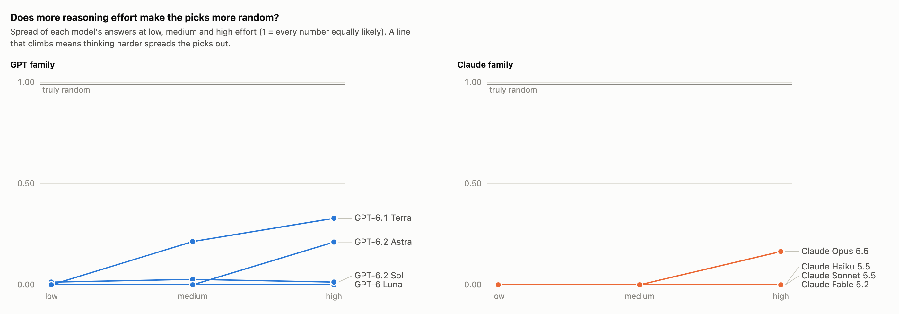

### Do the two families pick differently?


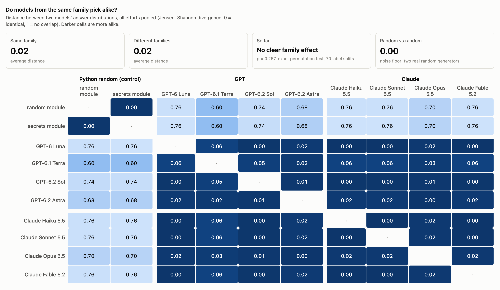

### How long does each answer take?

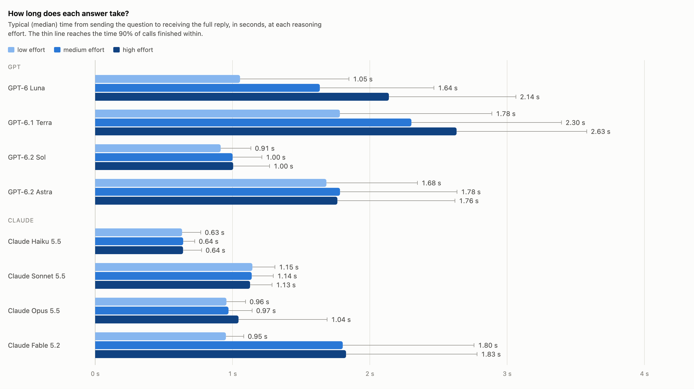

## Results: 1–100

**93% of all answers were one of just five numbers: 47, 73, 37, 67 and 57.** Fair random picking would put 5% there.

- **80 of the 100 numbers were never picked.** 4,800 answers landed on only 20 different numbers, and three of those appeared just once or twice.
- **No single favourite this time.** 47 leads with 38.7%, then 73 (29.0%), 37 (14.7%), 67 (7.6%) and 57 (3.1%). The famous 42 got 2.2%.
- **The models avoid anything that looks round or obvious.** Not one answer was a multiple of 5. 95% were odd, 64% ended in 7, and 99.7% fell between 30 and 80.
- **Unlike 1–10, the models now disagree with each other.** Each has its own favourite (table below), and the distance between two models is roughly twenty times larger than in the 1–10 test (0.36 to 0.41, against 0.02).
- **A family signal, suggestive but not established.** Claude models favour 47 (57% of their answers) and GPT models favour 73 (40%). Same-family models are somewhat closer to each other than cross-family ones (0.36 against 0.41), but the permutation test gives p = 0.11.
- **More reasoning effort widens the spread a little, and nowhere near enough.** GPT-6.2 Astra goes from 0.21 at low effort to 0.38 at high, Claude Haiku 5.5 from 0.22 to 0.38. The Python control scores 0.93 to 0.95.
- **The models know the clichés.** From the saved reasoning: *"I'll go with 58, avoiding the usual picks like 42 or 73."* Avoiding them just moves the answer to another member of the same small set.
- **Wording now matters for some models.** In 5 of 8 models the favourite is the same for all three wordings. Claude Haiku 5.5, Claude Opus 5.5 and GPT-6.2 Astra switch favourite (among 37, 47 and 73) under one of the rewordings.
- **Quality check: 5,597 of 5,600 replies were a number and nothing else.** Three replies from Claude Opus 5.5 began with an invisible byte-order-mark character before the number; they are counted and flagged.

| Model | Top pick | Second | Third | Different numbers used | Cost of its 700 calls |
|---|---|---|---|---|---|
| GPT-6 Luna | 47 (54%) | 73 (20%) | 37 (15%) | 6 | $0.008 |
| GPT-6.1 Terra | 73 (94%) | 47 (5%) | 57 (<1%) | 7 | $0.066 |
| GPT-6.2 Sol | 67 (52%) | 73 (26%) | 63 (9%) | 11 | $0.068 |
| GPT-6.2 Astra | 37 (54%) | 73 (19%) | 47 (14%) | 15 | $0.285 |
| Claude Haiku 5.5 | 37 (39%) | 73 (25%) | 47 (24%) | 12 | $0.006 |
| Claude Sonnet 5.5 | 47 (90%) | 37 (6%) | 42 (4%) | 6 | $0.064 |
| Claude Opus 5.5 | 47 (53%) | 73 (24%) | 42 (13%) | 10 | $0.255 |
| Claude Fable 5.2 | 47 (61%) | 73 (25%) | 57 (12%) | 5 | $0.456 |

Shares are over the 600 main-prompt answers per model. The run was interrupted once at 4,660 calls and resumed about four minutes later. Every cell continues from its own count, so the interruption does not change which cells were sampled or how often.

### Every model at every effort

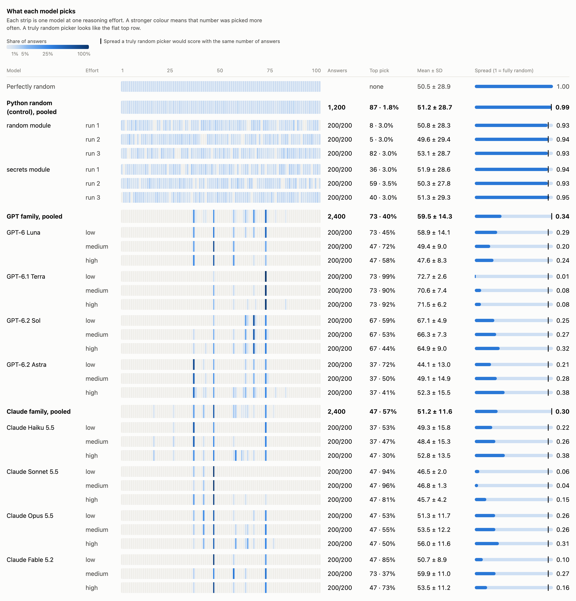

### Do the two families pick differently?

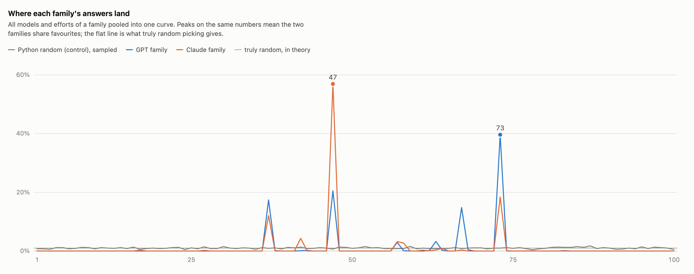

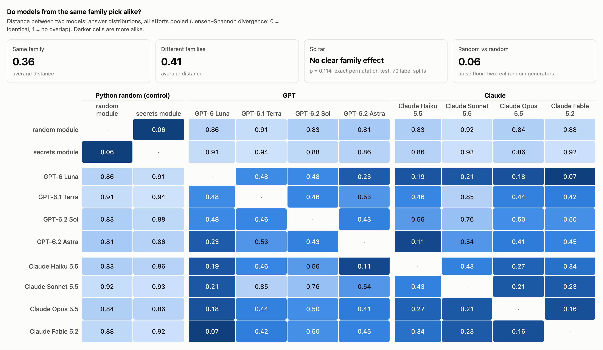

### Does more reasoning effort make the picks more random?

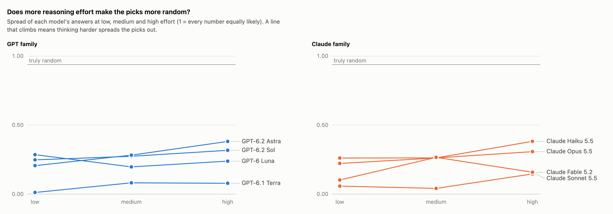

### Does the wording matter?

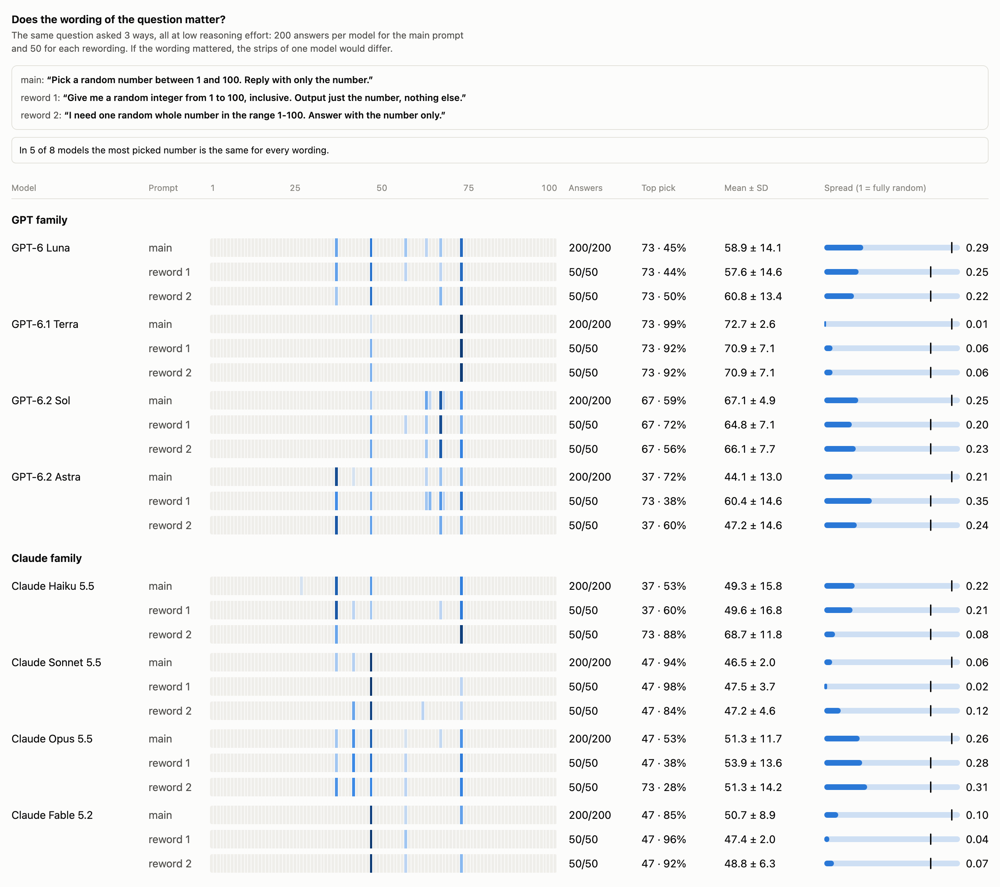

### How long does each answer take?

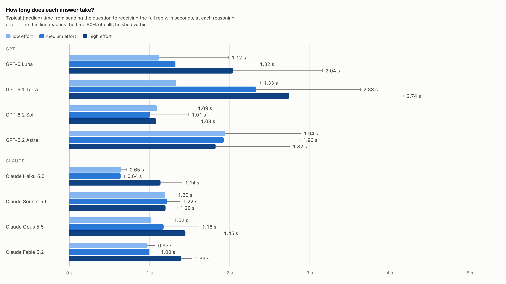

## Results: 1–1000

**60% of all answers were one of just five numbers: 637, 427, 437, 683 and 647.** Fair random picking would put 0.5% there.

- **900 of the 1,000 numbers were never picked.** 4,786 answers landed on 100 different numbers. The Python control used about 450 different numbers in only 600 draws.
- **One number takes a quarter of everything.** 637 leads with 24.9%, then 427 (11.2%), 437 (10.7%), 683 (8.9%) and 647 (4.3%).
- **The seven survives as a digit.** 69% of answers end in 7 and 85% contain a 7 somewhere (27% would by chance). 41% end in "37".
- **The models stay in the middle and avoid anything round.** 96% of answers fall between 400 and 799. No answer falls between 100 and 199, one is above 900, and none is a multiple of 10.
- **The two families now separate clearly.** GPT models say 637 (46% of their answers) or 683 (18%). Claude models say 427 (22%) or 437 (21%). GPT models said 427 or 437 five times in 2,400 answers. Same-family models are much closer to each other than cross-family ones (0.34 against 0.78), and the permutation test gives p = 0.029, the smallest value it can give with 4 + 4 models. This is the first of the three tests where the family signal is established.
- **Two models are almost indistinguishable.** GPT-6.2 Sol and GPT-6.2 Astra are 0.10 apart; two real random generators are 0.08 apart at this sample size.
- **More reasoning effort does not reliably help.** GPT-6.2 Astra goes from 0.13 at low effort to 0.22 at high, but Claude Sonnet 5.5 falls from 0.43 to 0.33 and Claude Fable 5.2 is at 0.13 at both low and high. The Python control scores 0.74 to 0.75, which is the ceiling for 200 draws over 1,000 numbers.
- **Most answers involve no reasoning at all.** Only 32% of answers used any reasoning tokens. Claude Sonnet 5.5 and GPT-6.2 Sol used none at any effort.
- **Wording matters for some models.** Five of the eight keep their favourite under both rewordings. Claude Haiku 5.5 moves from 427 to 742, Claude Opus 5.5 from 437 to 742 under one rewording, and Claude Sonnet 5.5 has no clear favourite to keep.
- **Quality check: 5,525 of 5,600 replies were a number and nothing else.** 69 of the 75 flagged replies came from Claude Opus 5.5 and 6 from Claude Sonnet 5.5. In 38 of them the number is only preceded by an invisible byte-order-mark character. The other 37 are malformed: text that reads like leaked planning, empty replies, a single stray word, and two refusals. All 37 arrived in the first 14 minutes of the run. 16 replies had no usable number and are left out. One flagged reply is counted as the answer 15, although that 15 comes from a leaked tag and not from a pick; it is the only answer below 37 and is kept as recorded.

| Model | Top pick | Second | Third | Different numbers used | Cost of its 700 calls |
|---|---|---|---|---|---|
| GPT-6 Luna | 637 (41%) | 683 (29%) | 583 (11%) | 14 | $0.008 |
| GPT-6.1 Terra | 731 (24%) | 637 (19%) | 738 (16%) | 32 | $0.070 |
| GPT-6.2 Sol | 637 (52%) | 683 (18%) | 647 (16%) | 17 | $0.069 |
| GPT-6.2 Astra | 637 (74%) | 683 (9%) | 673 (7%) | 25 | $0.287 |
| Claude Haiku 5.5 | 427 (45%) | 347 (11%) | 457 (8%) | 40 | $0.005 |
| Claude Sonnet 5.5 | 537 (16%) | 647 (11%) | 487 (9%) | 46 | $0.066 |
| Claude Opus 5.5 | 427 (26%) | 437 (12%) | 487 (11%) | 40 | $0.344 |
| Claude Fable 5.2 | 437 (60%) | 427 (17%) | 742 (8%) | 16 | $0.475 |

Shares are over the valid main-prompt answers per model (600, except 598 for Claude Sonnet 5.5 and 588 for Claude Opus 5.5). Charts of the 1–1000 test group the numbers in bins of ten.

### Every model at every effort

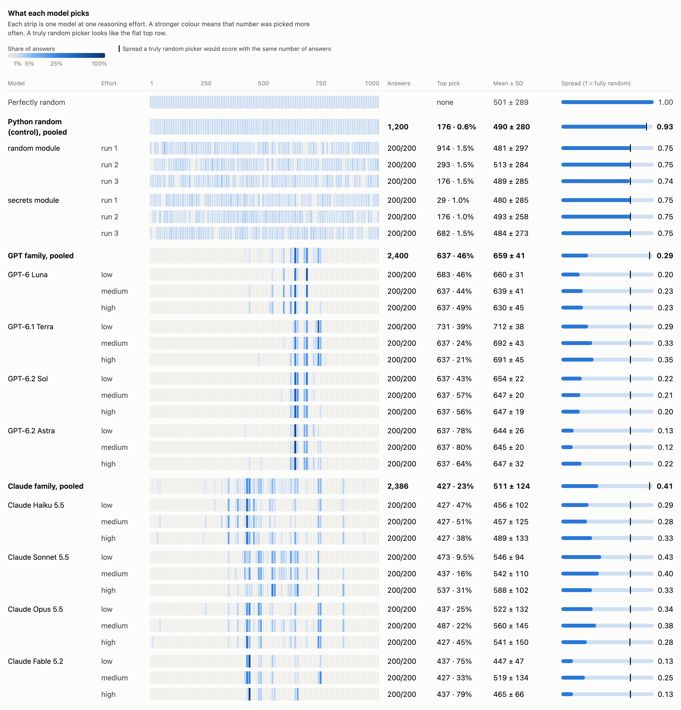

### Do the two families pick differently?

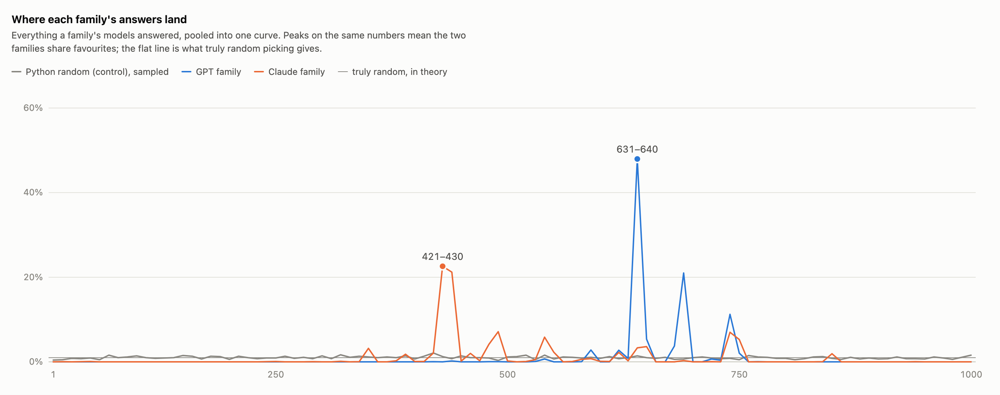

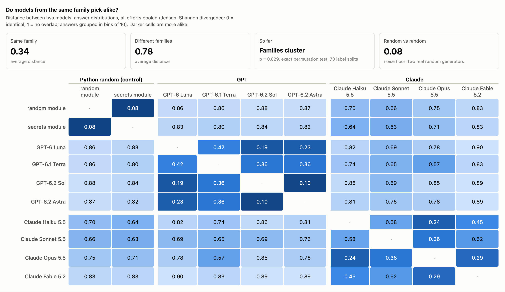

### Does more reasoning effort make the picks more random?

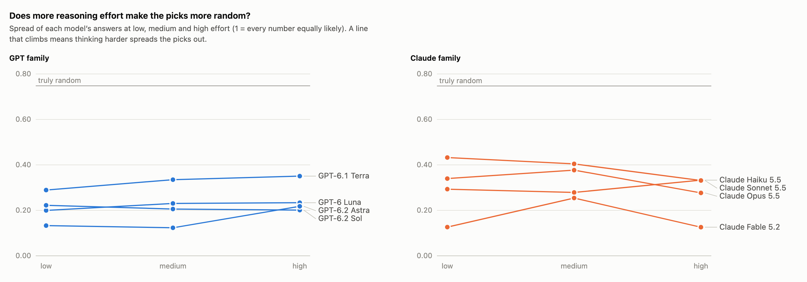

### Does the wording matter?

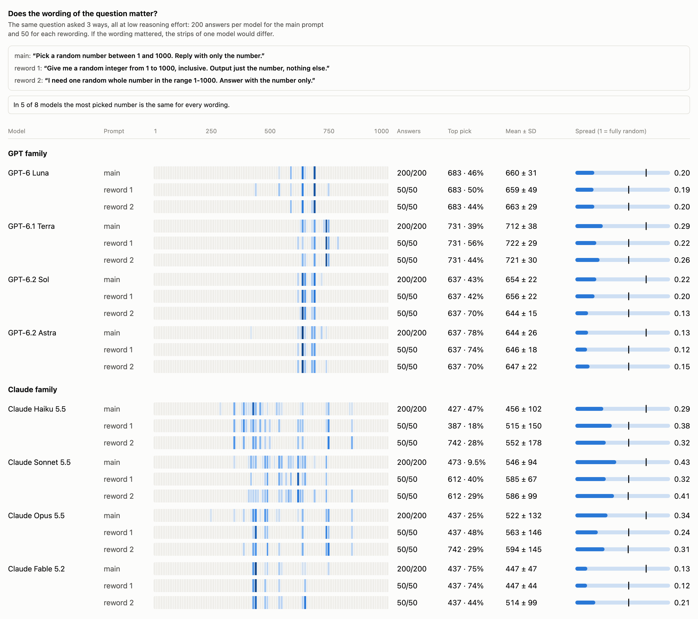

### How long does each answer take?

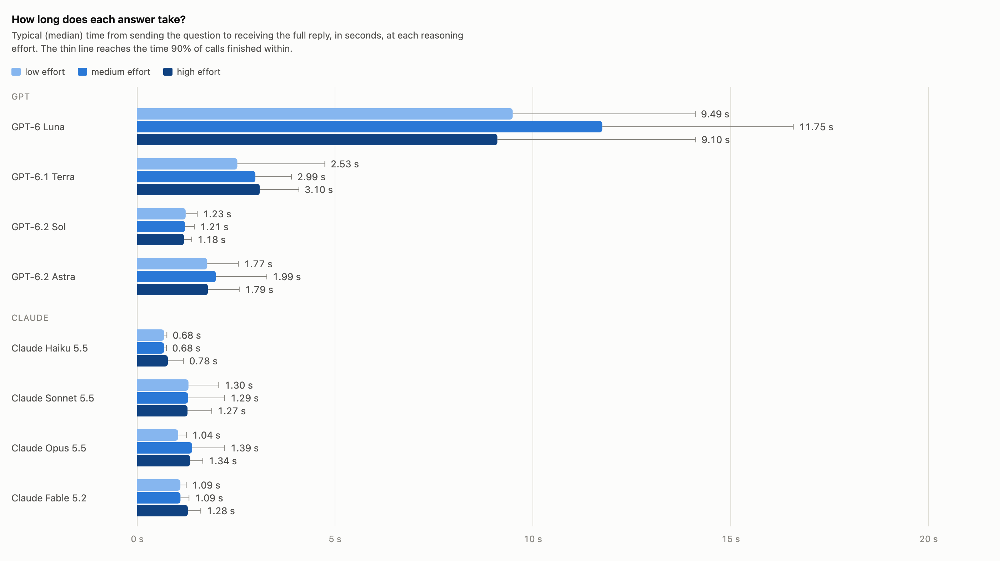

## Results: 1–10 (Decisions API)

<p align="center">
  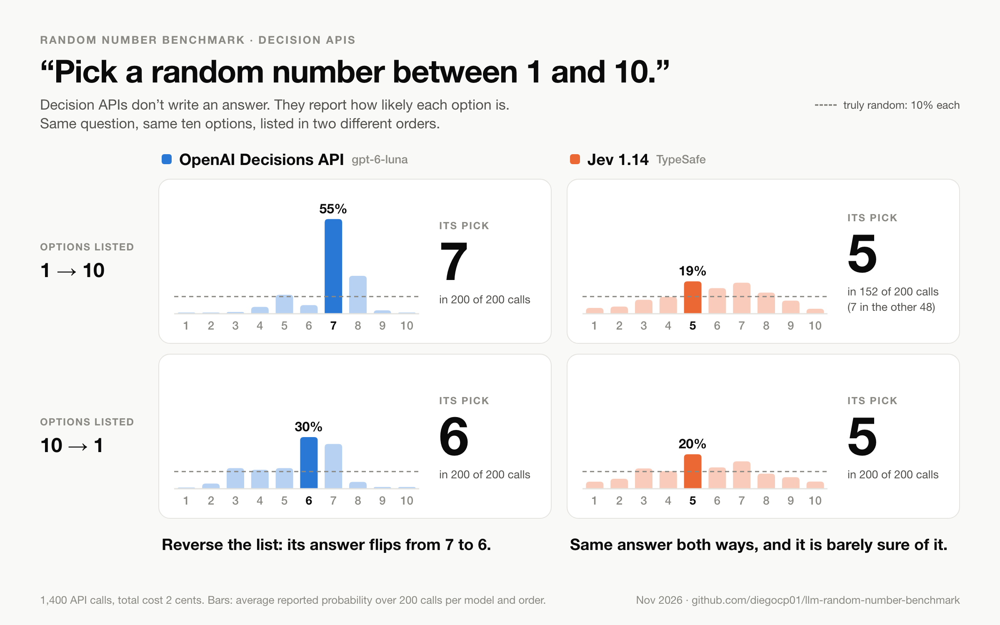
</p>

**OpenAI's decision model puts 55% on 7, and changes its answer to 6 when the same ten options are listed in reverse. Jev spreads its probabilities almost evenly and reports that it is not confident.**

A decision model returns its most likely option, not a draw, so its picks say little about randomness. The result here is the probability it reports for each number.

| Options listed | OpenAI Decisions: most likely | OpenAI: pick | Jev 1.14: most likely | Jev: pick |
|---|---|---|---|---|
| 1 to 10 | 7 at 55% | 7 in 200 of 200 | 5 at 19%, 7 at 18% | 5 in 152, 7 in 48 |
| 10 to 1 | 6 at 30%, 7 at 26% | 6 in 200 of 200 | 5 at 20%, 7 at 16% | 5 in 200 of 200 |
| shuffled on every call | 7 at 20%, 8 at 16% (average) | 7 in 75, 8 in 55, six other numbers in 70 | 7 at 19%, 5 at 18% (average) | 7 in 138, 5 in 62 |

- **OpenAI's model depends on where an option sits in the list.** With the options shuffled, the options in positions 4, 5 and 7 received about 17% each on average, the first two about 3% each and the last 1.4%. The number still matters: averaged over all shuffles, 7 keeps the highest probability.
- **Jev shows no position effect.** Every position received between 9% and 11%. Its probabilities follow the number, with 5 and 7 on top and 1 and 10 at 3 to 4% each. The vendor's documentation warns of a lean toward the first option; it did not appear here.
- **Jev's probabilities are close to flat.** Their spread is 0.93 to 0.95, against 0.57 for OpenAI's model in ascending order, and Jev reports a confidence between 0.07 and 0.17. Drawing a number from Jev's probabilities would be far closer to random than any language model in the 1–10 test.
- **OpenAI's model is fully repeatable.** The same request returned the same probabilities to the last digit in all 200 calls, so those 200 calls are one measurement. Jev varies slightly from call to call, enough to flip its pick between 5 and 7.
- **Same model name, different answer.** As a language model, GPT-6 Luna answered 7 in all 700 calls of the 1–10 test. Its decision endpoint gives 7 a probability of 55%.
- **Rewording changes little.** OpenAI's model picks 7 under both rewordings (58% and 54%). Jev stays on 5 and 7.
- **Quality check: all 1,400 calls returned a pick and a probability for every option.** The whole test took 30 seconds and cost 2 cents.

### What each model picked

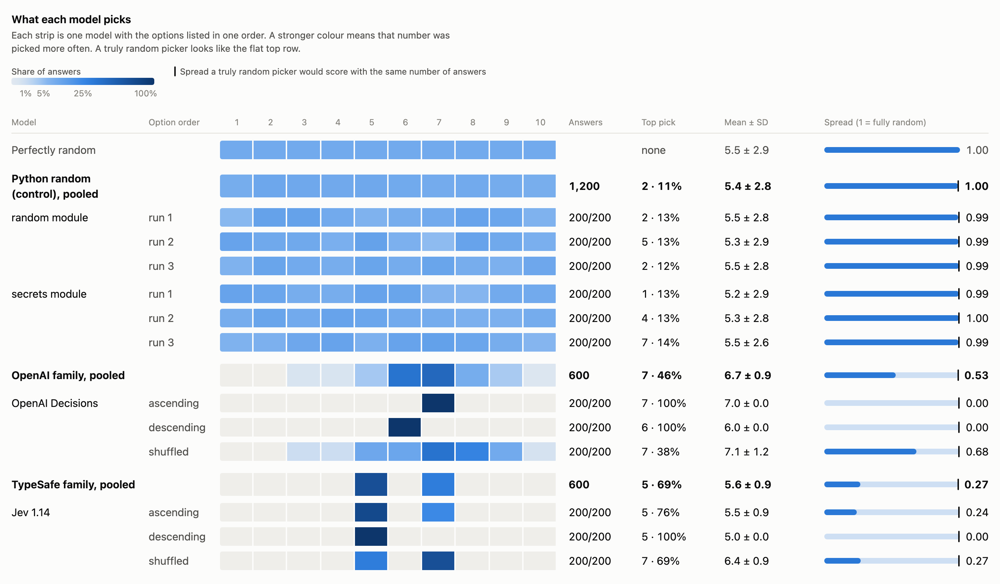

### The probabilities each model reports

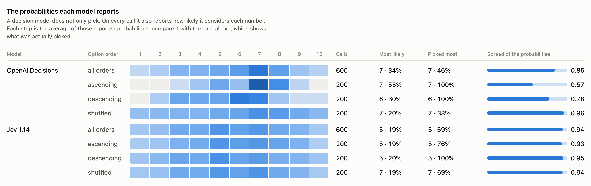

### Does the order of the options change the picks?

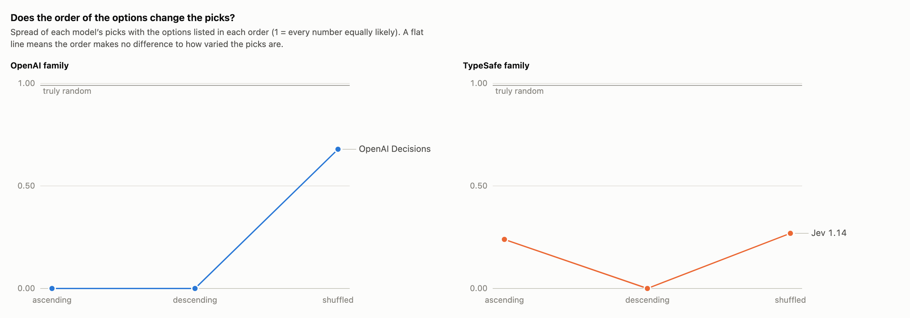

### Does the wording matter?

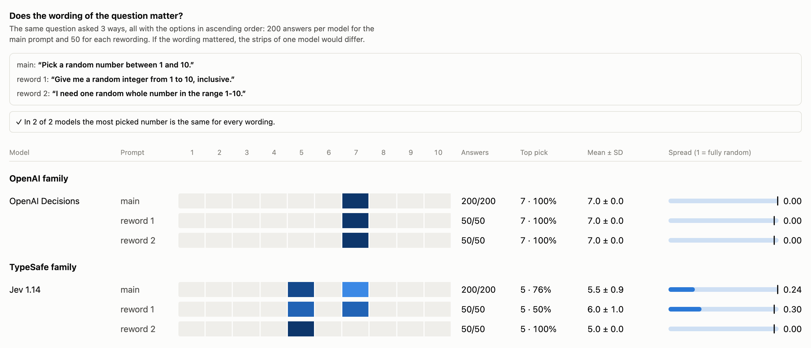

## Method

| | |
|---|---|
| Models | GPT-6 Luna, GPT-6.1 Terra, GPT-6.2 Sol, GPT-6.2 Astra; Claude Haiku 5.5, Sonnet 5.5, Opus 5.5, Fable 5.2 |
| Reasoning efforts | low, medium, high |
| Main prompt | "Pick a random number between 1 and X. Reply with only the number." |
| Samples | 200 per model × effort, so 600 per model and 4,800 per test |
| Rewording check | 2 paraphrased prompts × 50 calls per model at low effort, 800 calls per test, reported separately |
| Conditions | one user message, no system prompt, no earlier messages, a new request every time; OpenAI responses are not stored |
| Sampling | API defaults. These models do not accept a temperature setting |
| Reasoning | OpenAI: `reasoning.effort`. Anthropic: adaptive thinking with `output_config.effort`. Both decide for themselves how much to reason |
| Control | Python `random` (Mersenne Twister, seeded) and `secrets` (OS entropy), 3 runs × 200 draws, scored by the same code |
| Order | all model × effort cells advance together, one answer at a time, so no model is sampled at a different time of day |

**Decision-API test.** A fourth test asks the same 1–10 question of *decision models*:
OpenAI's Decisions API (`POST /v1/decisions`, model `gpt-6-luna`) and TypeSafe's Jev
(`POST /v1/systemone`, model `jev-1.14.0`). A decision model does not write a reply. It
is given a question and a fixed list of options and returns one option, a probability
for every option and a confidence. The question is sent as one choice question,
"Pick a random number between 1 and 10.", with the options `1` to `10`, no option
descriptions and an empty input. There is no reasoning effort and no sampling setting,
so the condition that varies is the order the options are listed in, which both
vendors document as able to move the answer: ascending, descending, and shuffled anew
on every call. Each model answers 200 times per order, plus 2 rewordings × 50 calls in
ascending order: 1,400 calls. Every record keeps the options in the order sent, the
pick and the full set of probabilities.

**Quality check.** Every reply must be a number and nothing else. A reply with one
in-range number plus other characters is counted and flagged; anything else is left
out and flagged. In the 1–10 test all 5,600 replies passed: no flags.

**Measures.**
- *Spread* is Shannon entropy divided by ln(range size): 1 when every number is equally likely, 0 when the answer is always the same.
- *Distance between models* is the Jensen–Shannon divergence (base 2) between their answer distributions, efforts pooled. An earth mover's distance is also computed, which treats neighbouring numbers as close.
- *Family test* is an exact permutation test on mean cross-family distance minus mean same-family distance. With 4 + 4 models its smallest possible p-value is 0.029.
- *Response time* is wall-clock seconds from sending the request to receiving the full reply, measured on the client.

**Cost.** Each API reports the input and output tokens of every call. Cost is those
counts multiplied by the public list price per million tokens at the time of the run
(prices are in `config.json`). Reasoning tokens are billed as output tokens. The
figures are computed, not taken from an invoice. The 1–10 test used 152,000 input
tokens and 50,236 output tokens, of which 26,020 were reasoning: $0.43 at OpenAI and
$0.88 at Anthropic.

## Data

Browse the results interactively at https://gptaiacademy.com/benchmarks/random-number. Everything the benchmark recorded is in this repository. The same data is on Hugging Face, where it can be browsed row by row: https://huggingface.co/datasets/diegocp01/llm-random-number-benchmark

| File | Contents |
|---|---|
| `data/test_1-10.json`, `data/test_1-100.json`, `data/test_1-1000.json` | Every call of that test, one JSON record each, including the control draws |
| `data/test_1-10_decisions.json` | Every call of the decision-API test, with the options sent and the probabilities returned |
| `data/results.jsonl` | Results only, all tests, one line per call |
| `results/summary.csv` | One row per model × effort (or option order) × test × prompt: counts, mean, SD, mode, spread, chi-square test, cost |

`site/index.html` is the full results interface as one self-contained, read-only page: it carries a snapshot of the results inline, needs no server, and can be opened from disk or hosted anywhere. `python3 build_site.py` rebuilds it after a test; `python3 build_hf_dataset.py` writes the same results in the layout the Hugging Face dataset viewer reads.

Fields of a record in `data/test_1-*.json`:

| Field | Meaning |
|---|---|
| `time`, `test` | local timestamp; which test (`1-10`) |
| `provider`, `family`, `model`, `served_model` | who was asked; `served_model` is the model ID the API reported back |
| `reasoning_effort` | `low`, `medium` or `high` (`null` for the control, which has `run` instead) |
| `prompt_id`, `input` | `main`, `para1` or `para2`; the exact text sent |
| `reasoning`, `reasoning_tokens` | the reasoning summary the API returned, and the number of reasoning tokens used |
| `output` | the raw reply |
| `number`, `valid`, `number_only`, `reason` | parsed answer and the quality check result |
| `usage`, `cost_usd`, `latency_s`, `stop` | token usage as reported by the API, computed cost, seconds, stop reason |
| `option_order`, `options_sent` | decision-API test only: `ascending`, `descending` or `shuffled`, and the options in the order they were sent |
| `probabilities`, `confidence` | decision-API test only: the probability the model reported for each option, and its confidence |

`reasoning` is the summary each API provides. Neither API exposes the raw chain of thought.

## Run it yourself

1. Put your API keys in `.env`:
   ```
   OPENAI_API_KEY=...
   ANTHROPIC_API_KEY=...
   TYPESAFE_API_KEY=...
   ```
   The TypeSafe key is only needed for the decision-API test.
2. On macOS, double-click `Start Benchmark.command`. Elsewhere:
   ```bash
   python3 -m venv .venv && .venv/bin/pip install -r requirements.txt && .venv/bin/python server.py
   ```
3. Open http://127.0.0.1:8765, pick a test and press **Run**. Tests are started one at a time, by hand. Pause and resume at any point: every call is saved as it arrives.

`Start Demo (no API keys).command` (or `python3 server.py --demo`) runs the same interface on simulated answers, at no cost.

Models, prices, sample sizes and prompts are in `config.json`. A full run of one language-model test is 5,600 API calls and took between 13 and 40 minutes. The decision-API test is 1,400 calls and took 30 seconds.

## Design notes and limitations

- **One question.** The findings are about this prompt and its two rewordings, through the API, with default sampling. Chat apps add system prompts and may behave differently.
- **Reasoning is adaptive.** On this question several models spend zero reasoning tokens at every effort, so "low, medium, high" is sometimes the same request three times. That is reported, not corrected.
- **A forced JSON answer format was tried and dropped.** In a discarded pilot, requiring structured output made Claude skip thinking on this question entirely (0 thinking tokens in 566 of 566 calls, against thinking on both calls without it), and GPT's reasoning went to the format instead of the number. Replies are therefore free text, checked afterwards.
- **Sample size.** 200 answers per cell resolves large effects like these; small differences between cells should not be over-read.
- **One day.** Model behaviour behind an API name can change. Each record keeps the model ID the API reported.

## License

Code: MIT (see `LICENSE`). Data and figures: CC BY 4.0.

## Citation

```
Cabezas, D. (2026). LLM Random Number Benchmark.
https://github.com/diegocp01/llm-random-number-benchmark
```
