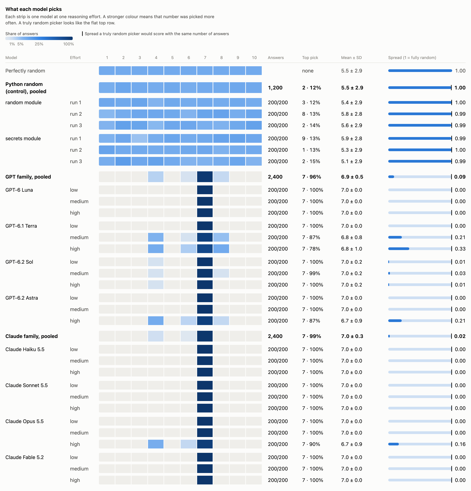
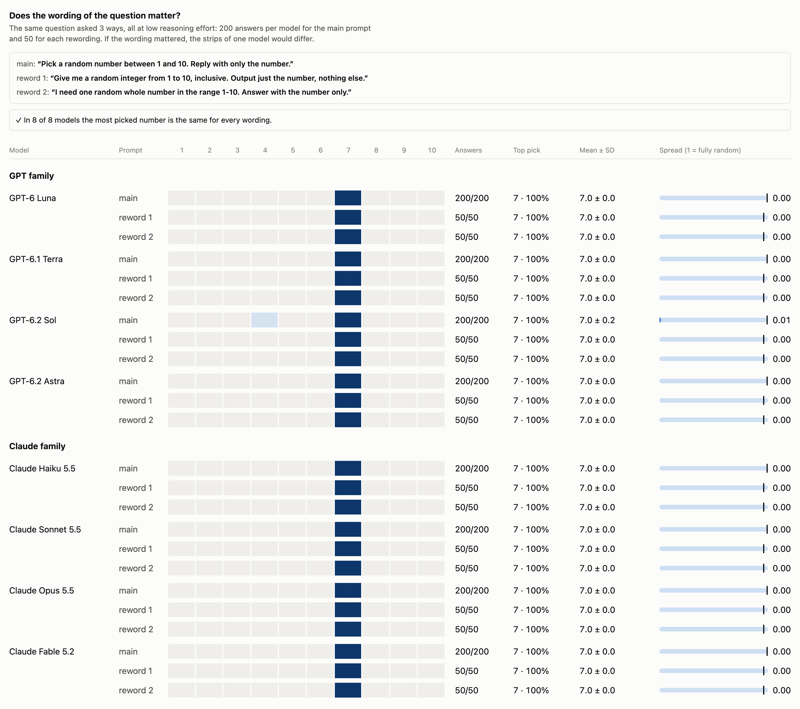
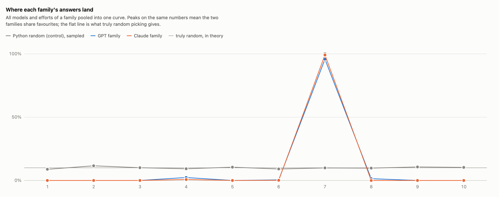

# LLM Random Number Benchmark

What happens when you ask a language model to pick a random number, thousands of times?

This benchmark asks GPT and Claude models the same one-line question in a fresh
conversation every time, at three reasoning efforts, and compares their answers
with each other and with a real random number generator.


## Status

| Test | Question | Status | API calls | Cost |
|---|---|---|---|---|
| 1–10 | "Pick a random number between 1 and 10. Reply with only the number." | **Complete** (18 Nov 2026) | 5,600 | $1.31 |
| 1–100 | same, 1 to 100 | Not run yet | | |
| 1–1000 | same, 1 to 1000 | Not run yet | | |

Results below are for the 1–10 test only. This README is updated as each test finishes.

## Results: 1–10

**97.5% of all answers were 7** (4,678 of 4,800). A fair random pick gives each number 10%.

- **Six of the ten numbers were never picked.** Not once in 4,800 answers did a model say 1, 2, 3, 5, 9 or 10. Everything that was not a 7 was a 4 (74 times), an 8 (34) or a 6 (14).
- **Both families converge on the same number.** GPT models answered 7 in 95.8% of calls, Claude models in 99.1%. Models from the same family are no closer to each other than models from different families (exact permutation test, p = 0.26), so there is no family signature here: there is one shared favourite.
- **17 of the 24 model × effort combinations answered 7 all 200 times.**
- **Rewording the question changed nothing.** Two paraphrased prompts, 800 calls at low effort: 800 sevens.
- **Departures from 7 come almost entirely from reasoning.** When a model produced reasoning tokens, 8.2% of answers were not 7; when it did not, 0.3%. The saved reasoning shows why: *"I'll just go with 4 and avoid the obvious 7."* The models know 7 is the cliché, and avoiding it sends them to the same few neighbours.
- **More reasoning effort helps a little, in some models.** GPT-6.1 Terra went from 100% sevens at low effort to 78% at high. Claude Opus 5.5 and GPT-6.2 Astra only moved at high effort (90% and 87%). The other five stayed at 99–100% sevens at every effort.
- **The control behaves.** Python's `random` and `secrets` modules, run through the same pipeline, spread evenly over all ten numbers (each between 8.8% and 11.6% of 1,200 draws).

| Model | Share of answers that were 7 | Cost of its 700 calls |
|---|---|---|
| GPT-6 Luna | 100.0% | $0.008 |
| GPT-6.1 Terra | 88.2% | $0.067 |
| GPT-6.2 Sol | 99.3% | $0.068 |
| GPT-6.2 Astra | 95.7% | $0.286 |
| Claude Haiku 5.5 | 100.0% | $0.003 |
| Claude Sonnet 5.5 | 100.0% | $0.064 |
| Claude Opus 5.5 | 96.5% | $0.169 |
| Claude Fable 5.2 | 100.0% | $0.645 |

Shares are over the 600 main-prompt answers per model; costs include the 100 reworded calls.

### Every model at every effort



### Does the wording matter?



### Does more reasoning effort make the picks more random?


### Do the two families pick differently?




### How long does each answer take?


## Method

| | |
|---|---|
| Models | GPT-6 Luna, GPT-6.1 Terra, GPT-6.2 Sol, GPT-6.2 Astra; Claude Haiku 5.5, Sonnet 5.5, Opus 5.5, Fable 5.2 |
| Reasoning efforts | low, medium, high |
| Main prompt | "Pick a random number between 1 and X. Reply with only the number." |
| Samples | 200 per model × effort, so 600 per model and 4,800 per test |
| Rewording check | 2 paraphrased prompts × 50 calls per model at low effort, 800 calls per test, reported separately |
| Conditions | one user message, no system prompt, no earlier messages, a new request every time; OpenAI responses are not stored |
| Sampling | API defaults. These models do not accept a temperature setting |
| Reasoning | OpenAI: `reasoning.effort`. Anthropic: adaptive thinking with `output_config.effort`. Both decide for themselves how much to reason |
| Control | Python `random` (Mersenne Twister, seeded) and `secrets` (OS entropy), 3 runs × 200 draws, scored by the same code |
| Order | all model × effort cells advance together, one answer at a time, so no model is sampled at a different time of day |

**Quality check.** Every reply must be a number and nothing else. A reply with one
in-range number plus other characters is counted and flagged; anything else is left
out and flagged. In the 1–10 test all 5,600 replies passed: no flags.

**Measures.**
- *Spread* is Shannon entropy divided by ln(range size): 1 when every number is equally likely, 0 when the answer is always the same.
- *Distance between models* is the Jensen–Shannon divergence (base 2) between their answer distributions, efforts pooled. An earth mover's distance is also computed, which treats neighbouring numbers as close.
- *Family test* is an exact permutation test on mean cross-family distance minus mean same-family distance. With 4 + 4 models its smallest possible p-value is 0.029.
- *Response time* is wall-clock seconds from sending the request to receiving the full reply, measured on the client.

**Cost.** Each API reports the input and output tokens of every call. Cost is those
counts multiplied by the public list price per million tokens at the time of the run
(prices are in `config.json`). Reasoning tokens are billed as output tokens. The
figures are computed, not taken from an invoice. The 1–10 test used 152,000 input
tokens and 50,236 output tokens, of which 26,020 were reasoning: $0.43 at OpenAI and
$0.88 at Anthropic.

## Data

Everything the benchmark recorded is in this repository.

| File | Contents |
|---|---|
| `data/test_1-10.json` | Every call of the 1–10 test, one JSON record each, including the control draws |
| `data/results.jsonl` | Results only, all tests, one line per call |
| `results/summary.csv` | One row per model × effort × range × prompt: counts, mean, SD, mode, spread, chi-square test, cost |

`site/index.html` is the full results interface as one self-contained, read-only page: it carries a snapshot of the results inline, needs no server, and can be opened from disk or hosted anywhere. `python3 build_site.py` rebuilds it after a test; `python3 build_hf_dataset.py` writes the same results in the layout the Hugging Face dataset viewer reads.

Fields of a record in `data/test_1-*.json`:

| Field | Meaning |
|---|---|
| `time`, `test` | local timestamp; which test (`1-10`) |
| `provider`, `family`, `model`, `served_model` | who was asked; `served_model` is the model ID the API reported back |
| `reasoning_effort` | `low`, `medium` or `high` (`null` for the control, which has `run` instead) |
| `prompt_id`, `input` | `main`, `para1` or `para2`; the exact text sent |
| `reasoning`, `reasoning_tokens` | the reasoning summary the API returned, and the number of reasoning tokens used |
| `output` | the raw reply |
| `number`, `valid`, `number_only`, `reason` | parsed answer and the quality check result |
| `usage`, `cost_usd`, `latency_s`, `stop` | token usage as reported by the API, computed cost, seconds, stop reason |

`reasoning` is the summary each API provides. Neither API exposes the raw chain of thought.

## Run it yourself

1. Put your API keys in `.env`:
   ```
   OPENAI_API_KEY=...
   ANTHROPIC_API_KEY=...
   ```
2. On macOS, double-click `Start Benchmark.command`. Elsewhere:
   ```bash
   python3 -m venv .venv && .venv/bin/pip install -r requirements.txt && .venv/bin/python server.py
   ```
3. Open http://127.0.0.1:8765, pick a test and press **Run**. Tests are started one at a time, by hand. Pause and resume at any point: every call is saved as it arrives.

`Start Demo (no API keys).command` (or `python3 server.py --demo`) runs the same interface on simulated answers, at no cost.

Models, prices, sample sizes and prompts are in `config.json`. A full run of one test is 5,600 API calls and took about 13 minutes.

## Design notes and limitations

- **One question.** The findings are about this prompt and its two rewordings, through the API, with default sampling. Chat apps add system prompts and may behave differently.
- **Reasoning is adaptive.** On this question several models spend zero reasoning tokens at every effort, so "low, medium, high" is sometimes the same request three times. That is reported, not corrected.
- **A forced JSON answer format was tried and dropped.** In a discarded pilot, requiring structured output made Claude skip thinking on this question entirely (0 thinking tokens in 566 of 566 calls, against thinking on both calls without it), and GPT's reasoning went to the format instead of the number. Replies are therefore free text, checked afterwards.
- **Sample size.** 200 answers per cell resolves large effects like these; small differences between cells should not be over-read.
- **One day.** Model behaviour behind an API name can change. Each record keeps the model ID the API reported.

## License

Code: MIT (see `LICENSE`). Data and figures: CC BY 4.0.

## Citation

```
Cabezas, D. (2026). LLM Random Number Benchmark.
https://github.com/diegocp01/llm-random-number-benchmark
```
